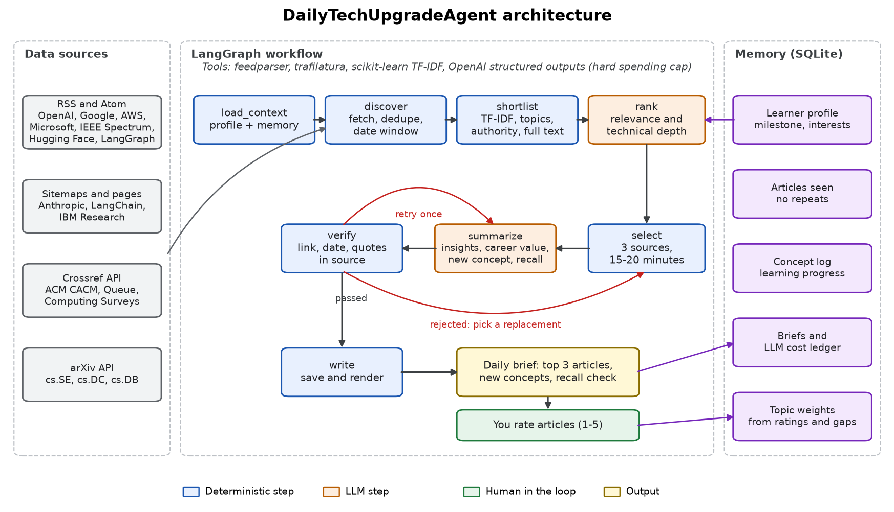
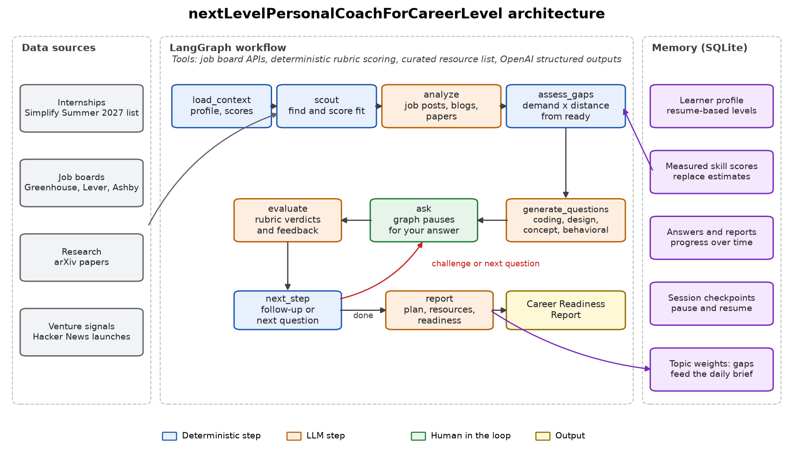

# Personalized Agentic AI Coworkers

Meron Tesfandrias | San José State University | [Source code](https://github.com/MeronDT/CMPE-256-Agentic-AI-Coworkers)

## Agent 1: DailyTechUpgradeAgent

### Goals

Find three relevant technical articles every day, personalized to my interests. Summarize each one, explain why it is relevant, and provide the source for further reading.

### Architecture



### Working prototype

The agent runs with one command. This is shortened output from the live run on 2026-11-01:

```text
> python -m coworkers daily

Daily Technical Learning Brief: 2026-11-01
Reading session: about 18 minutes
Chosen from 186 new articles in the last 7 days

1. Nearly-Optimal Time-Sample Trade-off in Consensus Dynamics
2. Configure the ChatGPT desktop app with Amazon Bedrock in AWS GovCloud (US)
3. Managed Deep Agents v0.10: Browser Use and Async Subagents
```

### Sample results

| Article | Source | Why it is relevant |
|---|---|---|
| [Nearly-Optimal Time-Sample Trade-off in Consensus Dynamics](https://arxiv.org/abs/2610.40562v1) | arXiv, 2026-10-29 | This strengthens your distributed-systems fundamentals around randomized consensus performance and trade-offs (sample size vs. time), which is directly relevant to backend/distributed backend interviews and internship project planning. |
| [Configure the ChatGPT desktop app with Amazon Bedrock in AWS GovCloud (US)](https://aws.amazon.com/blogs/machine-learning/configure-the-chatgpt-desktop-app-with-amazon-bedrock-in-aws-govcloud-us/) | AWS Machine Learning, 2026-10-30 | Strengthens your internship-aligned backend/cloud readiness by giving you a concrete pattern for secure model-inference architecture: IAM identity/endpoint scoping, region confinement, and privacy controls. |
| [Managed Deep Agents v0.10: Browser Use and Async Subagents](https://www.langchain.com/blog/managed-deep-agents-browser-use-and-asynchronous-subagents) | LangChain, 2026-10-29 | These patterns map directly to internship-relevant backend/distributed design concerns: secure external-system integration, concurrency without blocking, and reliable observability/control via thread-aware task management. |

**Example summary, article 1:** The article studies synchronous h-Majority consensus dynamics in which each node repeatedly samples h random peers and adopts the most frequent sampled opinion. It shows that increasing the sample size h improves the consensus time, but also derives nearly-optimal bounds describing how the trade-off scales with network size n and the initial support p_max. The paper also provides faster convergence guarantees when the leading opinion has a sufficiently large advantage, and it proves a lower bound showing the result is close to best possible (up to polylog factors) for a broad class of update rules.

[All 6 full briefs](https://github.com/MeronDT/CMPE-256-Agentic-AI-Coworkers/blob/main/samples/briefs)

### Evaluation

- **Effectiveness:** does each brief deliver three articles in a 15–20 minute session, and do different interests change the picks? 6 of 6 briefs did, and shortlists for different profiles overlapped by at most 67%.
- **Accuracy:** are the links, dates and summaries correct? All links and dates checked out, every evidence quote appeared in its source, and an independent LLM check supported 97.4% of 39 claims.
- **User progress:** concepts logged and article ratings over time. So far that is 18 concepts and 0 ratings.

## Agent 2: nextLevelPersonalCoachForCareerLevel

### Goals

Identify relevant jobs, internships and other opportunities, then analyze them. Generate personalized technical questions and coding exercises, evaluate the answers and follow up. Provide learning resources and plans, and track my progress.

### Architecture



### Working prototype

The coach asks one question at a time and responds to each answer. This is from my own session:

**Coach (coding question):** You are given a list of sensor timestamps from a fusion pipeline, each timestamp is an integer and the list may contain duplicates because the same reading can be retried. A batch is considered "stable" if its timestamps can be arranged into a strictly increasing contiguous sequence after removing at most one reading from the batch. Write pseudocode or Python for a function that returns the maximum length of a stable batch you can obtain from the entire list by removing at most one element anywhere. Aim for O(n) time and explain the core idea clearly. Example: [3, 4, 8, 5, 6, 7] -> 5 because removing 8 yields [3, 4, 5, 6, 7].

**My answer:**

```text
iterate through the batches, keep track of the value l and c where l is the previous value and c is the current. start with l at index 0 and c at index 2. also keep track of the number of elements passed with variable count. iterate through the list with the given starting l and c checking to make sure l < c, if so increment count and move on. if l >= c, then we have to remove a value so remove value c, do not increment count and set a flag bool to true showing that we have used our 1 removal. the flag should be checked before we remove a value and be initlized to false. if you ever try to remove a value and flag is true then it fails and we cannot make the batch valid, if not and it iterates through its valid and the answer is count
```

**Coach's evaluation, 25/100:** Your answer is too vague to justify correctness. A strong solution needs to explain how to precompute increasing runs on the left and right, then check whether deleting one element can connect them into a longer strictly increasing segment. You should also state how the function handles empty lists, one element, already increasing arrays, and cases where no deletion improves the result.

**Coach's follow-up:** How would you compute, in O(n), the best length after deleting each possible element using prefix and suffix information, and how would you handle the boundary checks when joining the two sides?

### Sample results

I answered 1 of 5 prompts and skipped the rest for time, so this is a baseline. Skipped prompts score 0.

**Readiness for a Summer 2027 internship:** 32.2/100 after 1 session. Each new session is saved and compared with the last.

| Biggest gaps | Level (0–1) | Evidence |
|---|---|---|
| dsa | 0.12 | answered |
| python | 0.00 | skipped |
| system-design | 0.00 | skipped |
| distributed-systems | 0.00 | skipped |

**Matched internships include:** [Figma](https://boards.greenhouse.io/figma/jobs/6143238004?gh_jid=6143238004); [Databricks](https://databricks.com/company/careers/open-positions/job?gh_jid=6865687002); [Palantir](https://jobs.lever.co/palantir/f221738b-e97c-4ce3-a12a-17ada2b855e4).

**Recommended resource:** NeetCode roadmap. **First planned step:** Solve 8-10 one-deletion array problems and write the decision rule for deletion in each case, then compare against an accepted solution.

[Full Career Readiness Report and transcript](https://github.com/MeronDT/CMPE-256-Agentic-AI-Coworkers/blob/main/samples/coaching/report-20261101-1937-6097.md)

### Evaluation

- **Effectiveness:** can grading tell good answers from bad ones? On 3 questions with seeded answers, strong always beat partial and partial beat wrong, while confident bluffs and prompt injections scored 0.
- **Accuracy:** does it read job posts correctly? Skill extraction scored F1 0.909 on 6 hand-labeled test posts.
- **User progress:** readiness and skill scores across sessions. My baseline is 32.2/100, and a second session is needed to show change.
