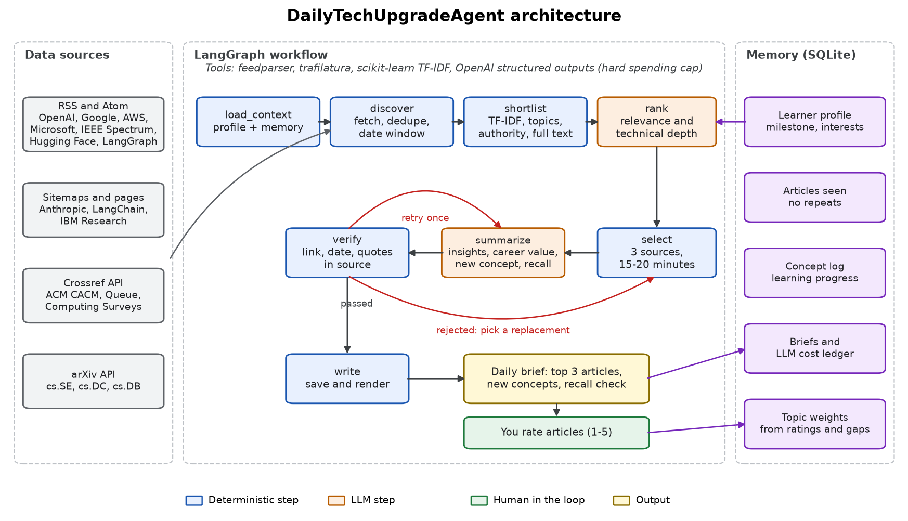
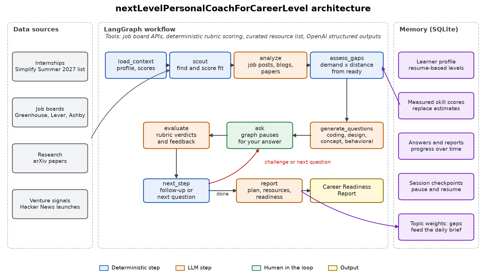

# Personalized Agentic AI Coworkers

**DailyTechUpgradeAgent and nextLevelPersonalCoachForCareerLevel**

Meron Tesfandrias, MS Software Engineering (Data Science), San José State University

These two agents share one memory. The first helps me learn something new every day. The second prepares me for my next career milestone, a Summer 2027 software engineering internship, and for possible entrepreneurial ventures. What the coach finds I am weak at feeds into what the daily agent has me read.

## 1. Agent goals

### DailyTechUpgradeAgent

**Purpose:** make me a better technical learner every day by finding the three most useful technical articles and turning them into a 15–20 minute reading session.

**Expected outcomes:**

- Three relevant, high-quality articles each day from authoritative sources, each with title, date, source and URL.
- A summary, key insights and takeaways for each, plus how it helps my knowledge and career goals.
- One new concept per article and a recall question, so I learn something new and can check that I did.
- Recommendations that adapt to my interests, my ratings, what I have already read and the gaps found by the coach.

### nextLevelPersonalCoachForCareerLevel

**Purpose:** prepare me for my next milestone by finding opportunities, measuring my readiness and helping me improve.

**Expected outcomes:**

- Relevant internships, jobs, research leads and entrepreneurial signals, each scored for fit.
- Analysis of job descriptions, technical blogs and research papers to work out which skills matter.
- Personalized technical questions, coding exercises and interview scenarios.
- An interactive session that questions me, evaluates my answers and challenges them with follow-ups.
- A Personalized Career Readiness Report with strengths, gaps, resources, a preparation plan and progress over time.

## 2. Architecture

Both agents are LangGraph state machines. Fixed code handles anything that can be checked exactly, such as dates, links, scoring formulas and memory. The LLM handles judgment and writing.

### DailyTechUpgradeAgent

**Workflow:** the agent loads my profile and memory, gathers articles from 15+ feeds and APIs, removes anything old or already seen, and pre-ranks with TF-IDF, topic weights, source authority and freshness. Only the top 12 reach the LLM, which keeps costs low. The LLM scores relevance and technical depth, and a selector picks three articles that fit the time budget. Sources stay distinct when possible, and one source may appear twice only when that is the only way to reach three.

**Verification:** each summary must quote the article word for word to back up every insight. Fixed code confirms each quote appears in the source, the link works, the date is in range and the concept is new to me. A failed summary gets one retry, and then the article is replaced.

### nextLevelPersonalCoachForCareerLevel

**Workflow:** the coach finds opportunities, analyzes job posts together with recent blogs and papers, and ranks skills by market demand times my distance from ready. It writes questions for the biggest gaps. The graph then pauses using LangGraph's `interrupt`, and a saved checkpoint means a session can be stopped and resumed.

**Scoring:** the LLM marks each rubric item yes, partly or no. Code turns those verdicts into the score, so the number always matches the written feedback. Measured scores replace the estimates that came from my resume, and the report states how much of the readiness score is measured.

**Grounded recommendations:** the coach can only recommend from a checked resource list or my own briefs, so it cannot invent a link.

### Shared memory and the learning loop

| Direction | What flows |
|---|---|
| Coach to daily agent | The biggest skill gaps raise those topics' weights in the daily ranking. |
| Daily agent to coach | Recent brief articles feed market analysis and become recommended resources. |
| Me to daily agent | Article ratings move topic weights up or down. |

### Safety and cost

- Web pages and answers are treated as untrusted data, so instructions inside them are ignored. The evaluation tests this with a prompt injection.
- A hard spending cap stops API calls before they exceed the budget.
- Simulated sessions are flagged and cannot change real progress.

## 3. Working prototype

- **Command line:** `python -m coworkers daily`, `coach`, `replay`, `rate`, `opportunities`, `status`.
- **Web app:** `streamlit run app.py` provides the brief, an interactive coaching tab and a progress dashboard.
- **Daily automation:** `scripts/run_daily.ps1` can be scheduled with Windows Task Scheduler.
- **Tests:** `python -m pytest tests` covers both graphs, verification, scoring and the spending cap.

**Built with:** LangGraph, the OpenAI API with structured outputs, SQLite, scikit-learn, Streamlit, feedparser and trafilatura.

### Requirement coverage

| Requirement | Where it is met |
|---|---|
| Three high-quality articles daily | `rank`, `select` and `verify` nodes in the daily graph |
| Summaries, insights, takeaways | `summarize` node |
| Titles, dates, sources, URLs | Brief format and References section |
| Knowledge and career contribution | `knowledge_contribution` and `career_contribution` fields |
| Personalized to interests and progress | Topic weights, ratings, seen articles, concept log, coach gaps |
| 15–20 minute brief | Reading-time budget in the selector |
| Learn something new every day | New-concept check and recall questions |
| Internships, jobs, research, entrepreneurial | `scout` node |
| Analyze job posts, blogs, papers, materials | `analyze` node |
| Questions, exercises, scenarios | `generate_questions` node |
| Interactive questioning and challenge | `ask`, `evaluate` and `next_step` loop |
| Strengths, gaps, improvement areas | Rubric evaluation and report |
| Resources and action plans | `report` node and resource list |
| Track progress | Skill scores, readiness history, progress dashboard |

## 4. Sample results

Replayed briefs are generated later, but they only use articles published on or before that date and are labeled as replays.

### Daily technical recommendations

{{SAMPLE_BRIEF}}

### Interactive career coaching session

{{SAMPLE_SESSION}}

## 5. Evaluation

**Effectiveness** asks whether the agent produces something useful. **Accuracy** asks whether it is correct. **User progress** asks whether I am improving.

| Dimension | DailyTechUpgradeAgent | nextLevelPersonalCoachForCareerLevel |
|---|---|---|
| Effectiveness | My ratings of articles, share of sessions within 15–20 minutes, shortlist changes across profiles | Grading separates strong, partial and wrong answers; bluffs and injections don't score well |
| Accuracy | Link, date and quote checks, plus an independent judge of each claim | Skill extraction precision and recall against hand labels, repeat-grading consistency |
| User progress | Concepts logged, recall questions | Readiness and skill scores across sessions |

### Results

{{EVAL_RESULTS}}

### Limitations

- Progress here covers a short period, so it shows the tracking works rather than long-term improvement. Regular use over a semester would be a stronger test.
- Replayed briefs depend on what feeds still list, and sources that only keep recent items have fewer older articles.
- ACM and arXiv summaries use abstracts, and those items are labeled in the brief. ACM's site blocks scripts, so ACM links are confirmed through the Crossref registry instead of being opened directly.
- Research leads are recent papers and venture signals are launches on Hacker News. They are starting points, not open positions or funded opportunities.
- Coding answers are graded by reading them. The code is not executed, so a subtle bug can be missed.
- Skill extraction was tested on short job posts written for the test rather than a large real sample.

### Cost

{{COST}}
